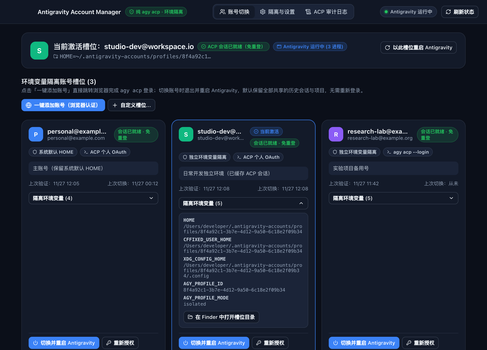
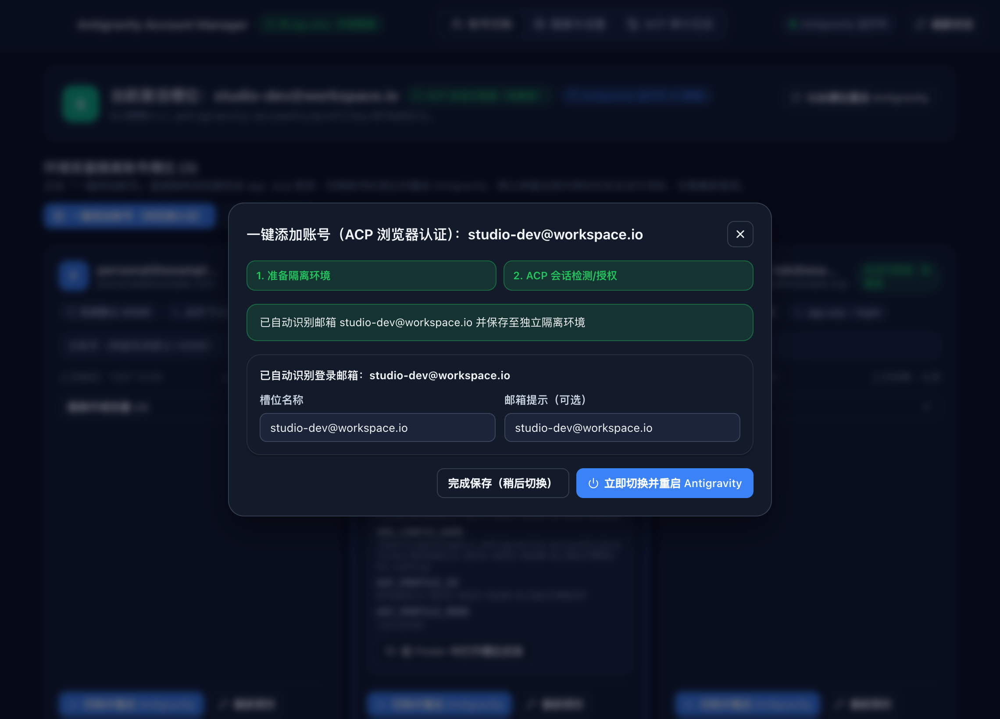
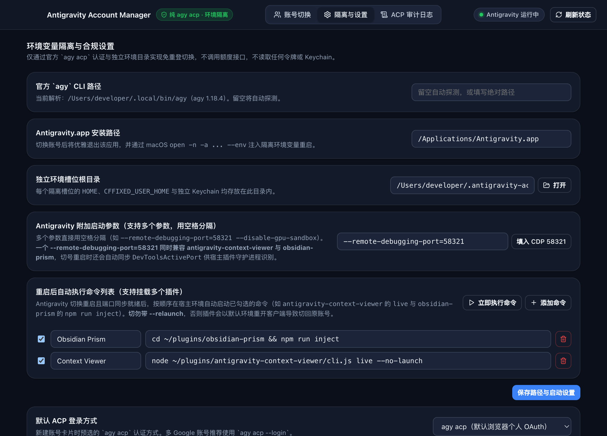
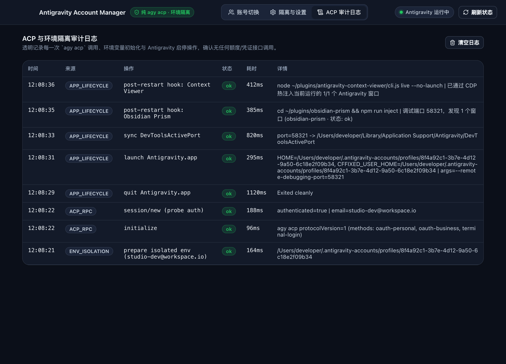
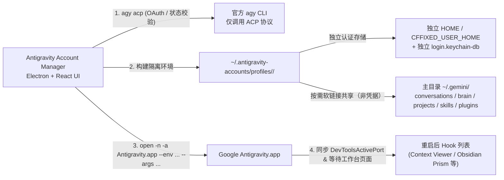

# Antigravity Account Manager

<p align="left">
  <a href="https://github.com/feiyuggg/antigravity-account-manager/releases/latest">
    
  </a>
  
  
  <a href="./LICENSE">
    
  </a>
</p>

专为 macOS Google Antigravity 打造的**多账号免重登切换工具**。通过隔离每个账号的 `HOME`、`CFFIXED_USER_HOME` 与独立 macOS Keychain 环境，配合官方 `agy acp` 认证流程，让你随时一键切换账号并重启 Antigravity，**无需反复登录**，同时无缝保留历史对话、项目与扩展插件。

---

## 界面预览

| 账号总览与环境变量隔离 | 一键浏览器 ACP 认证与自动识别邮箱 |
| :---: | :---: |
|  |  |

| 启动参数、多插件联动与数据共享设置 | 透明可核查的 ACP 审计日志 |
| :---: | :---: |
|  |  |

---

## 核心特性

- **一账号一隔离环境（切换免重登）**：
  为每个隔离槽位分配独立的 `HOME`、`CFFIXED_USER_HOME`、`XDG_*` 目录以及独立的 `login.keychain-db`。登录凭证相互隔离互不覆盖，切号时只需优雅退出 Antigravity 并以目标环境重启，立即免重登进入对应账号。
- **纯正 `agy acp` 认证 & 邮箱自动识别**：
  点击「一键添加账号（浏览器认证）」直接通过官方 `agy acp` 拉起 OAuth 流程（同时支持 `agy acp --login` 终端授权码与企业 Cloud OAuth），认证完成后自动探测账号邮箱并生成不重名的友好槽位名。
- **跨账号保留历史会话、项目与全局配置**：
  自动将主目录的对话（`conversations`、`brain`、`annotations`、`scratch`）、项目列表（`projects`）、`mcp_config.json` 及全局 `skills` / `plugins` / `rules` 安全软链接至隔离环境（认证目录绝不共享），切号后历史会话无缝续聊。
- **CDP 启动参数透传 & 第三方插件自动重挂载**：
  完整支持 `--remote-debugging-port=58321` 等自定义启动参数，支持为 `antigravity-context-viewer` 或 [`obsidian-prism`](https://github.com/abhiman1206/obsidian-prism) 等基于 CDP 的插件配置多条「重启后自动执行命令」：切号重启时自动同步 `DevToolsActivePort`、等待工作台 CDP 页面就绪、前置现代 Node 22+ 路径并按顺序挂载扩展，支持在设置页一键「立即执行命令」。
- **极简 macOS 状态栏托盘**：
  默认采用**纯图标显示**以彻底避免刘海屏菜单栏遮挡；也可随时切换开启固定宽度槽位编号（`#1` / `#2` 等宽显示），悬停显示完整信息，菜单内一键切号或新增账号。
- **全程审计可追溯**：
  内置「ACP 与环境隔离审计日志」，清晰展示每一次 `agy acp` RPC 调用、隔离目录准备、应用启停与插件 Hook 的耗时和输出结果。

---

## 工作原理架构



---

## 合规与安全声明

本工具在设计上严格遵守合规边界：

1. **只走官方 `agy acp` 协议**：所有登录、登出与会话状态检测均通过启动官方 `agy acp` 子进程完成。
2. **绝不读取或解析凭证**：不读取系统或隔离 Keychain 中的密钥内容，不解析 OAuth Token / Refresh Token / Cookie。
3. **绝不调用非授权接口**：不包含、不请求任何额度（quota）、用量（usage）、余额或账单查询 API；内置源码级隐私与合规审计。

---

## 安装与快速上手

### 1. 下载安装（macOS Apple Silicon `arm64`）

前往 [Releases 页面](https://github.com/feiyuggg/antigravity-account-manager/releases) 下载最新安装包：

- `Antigravity-Account-Manager-1.0.2-macOS-arm64.dmg`（推荐，打开后拖入 `Applications`）
- 或 `Antigravity-Account-Manager-1.0.2-macOS-arm64.zip`

> **首次打开提示处理**：当前 Release 使用本地 ad-hoc 签名（未经 Apple 公证）。若拖入 `/Applications` 后首次打开提示「无法验证开发者」或「已损坏」，请在终端执行一次：
> ```bash
> xattr -cr "/Applications/Antigravity Account Manager.app"
> ```

### 2. 日常使用

1. **前置条件**：确保本机已安装 Google Antigravity 及官方 `agy` CLI（通常位于 `~/.local/bin/agy` 或通过 `brew` / 安装器配置，可在「隔离与设置」中查看或指定路径）。
2. **纳管已有主号（可选）**：若当前系统已登录一个 Antigravity 账号，点击「纳管当前系统登录为第 1 个槽位」即可保留现有默认环境为槽位 `#1`。
3. **添加新账号**：点击右上角 **「一键添加账号（浏览器认证）」**，工具会自动新建隔离槽位、初始化独立 Keychain，并调用 `agy acp` 拉起浏览器授权；登录完成后自动识别并回填邮箱。
4. **随时一键切换**：点击任意卡片的 **「切换并重启 Antigravity」**（或从顶部状态栏图标菜单选择槽位），工具会自动退出当前 Antigravity，并注入该账号的隔离环境变量重新启动，直接免重登可用。

### 3. 联动第三方 CDP 插件示例

在 **「隔离与设置」** 中：

- **Antigravity 附加启动参数** 填入：`--remote-debugging-port=58321`
- **重启后自动执行命令列表** 可添加多个需要联动热挂载的命令，例如：
  - **Obsidian Prism**：`cd /path/to/obsidian-prism && npm run inject`
  - **Context Viewer**：`node /path/to/antigravity-context-viewer/cli.js live --no-launch`

> **注意**：重启后自动执行命令中**切勿附加 `--relaunch`**，否则插件自身会再次以系统默认 `HOME` 重开 Antigravity，导致账号被切回默认号。

---

## 本地开发与构建

```bash
# 1. 安装依赖
npm install

# 2. 类型检查与单元测试
npm run typecheck
npm test

# 3. 启动本地开发模式
npm run dev

# 4. 生成文档截图（无头 Electron 渲染）
npm run build && env -u ELECTRON_RUN_AS_NODE ./node_modules/.bin/electron scripts/capture-screenshots.mjs

# 5. 打包 macOS Apple Silicon Release (.app / .dmg / .zip / SHA256SUMS.txt)
npm run release:macos
```

生成产物位于 `release/` 目录：
- `Antigravity Account Manager.app`
- `Antigravity-Account-Manager-<version>-macOS-arm64.dmg`
- `Antigravity-Account-Manager-<version>-macOS-arm64.zip`
- `SHA256SUMS.txt`

---

## License

基于 [MIT License](./LICENSE) 开源。
